# MANBAR – Capstone 2 Technical Analysis (Chapters 4–7)

**Purpose of this document.** This document gives verified technical material for the MANBAR Capstone 2 report (Chapters 4, 5, 6 and 7). It was prepared by reading the actual source code, the live database structure, the configuration file structure and the project history. No source code or database data was changed to prepare it.

**Snapshot.** Analysis date: 10 October 2026. Environment: Windows 11, XAMPP, PHP 8.1.25, MariaDB 10.4.32, Apache. The project folder is `C:\xampp\htdocs\manbar`.

**Privacy rule followed.** No API keys, passwords, tokens, configuration values or real personal data appear in this document. Configuration is described only by setting name and by whether it is filled in.

## How to read the evidence labels

| Label | Meaning |
|---|---|
| **[V]** | Verified directly from the source code or the live database schema. |
| **[V-T]** | Verified by a test that was actually executed (details in Chapter 6). |
| **[D]** | Implemented, but runs in **demo mode** (no real external transaction). |
| **[O]** | **Optional integration**: supported in code, works only when a key is configured. |
| **[F]** | **Future plan**: not implemented. |
| **[M]** | Needs **manual verification** before it is cited in the report. |

## Corrections to the earlier capstone document

These points correct `docs/MANBAR_Capstone_Document.txt`, which was written earlier.

1. **Direct-message attachments are stored in the public folder, not in private storage [V].**
   - The earlier document said message attachments are stored in `storage/`.
   - In fact, `message_attachment_upload()` (`app/controllers/social.php`, line 49) saves them to `public/uploads/messages/` with a random 24-character hexadecimal name.
   - Course files, service portfolio files and project files are stored in `storage/` and are served only after a permission check.
   - Message attachments can be opened by anyone who knows the exact URL, without signing in.
2. **Route count.** The application has **177 routes: 69 GET and 108 POST [V]**. Three routes were missing from the earlier route list:
   - `POST /projects/{id}/tasks/{tid}` → `project_task_move`
   - `POST /api/messages/{with}/typing` → `api_message_typing`
   - `POST /admin/courses/{id}/toggle` → `admin_course_toggle`
3. **PHP file count.** There are **123 PHP files**. This includes the root `index.php` adapter used for shared hosting.

---

# CHAPTER 4 – SYSTEM ARCHITECTURE AND DESIGN

## 4.1 Database overview [V]

| Property | Value (verified) |
|---|---|
| DBMS | MariaDB 10.4.32. MySQL is the target; SQLite is also supported by `app/db.php` for development. |
| Storage engine | InnoDB for all 55 tables |
| Character set | `utf8mb4` with `utf8mb4_unicode_ci`, so Arabic and emoji are supported |
| Number of tables | **55** |
| Tables in the base install script (`database/schema.tpl.sql`) | 34 |
| Tables created at runtime by `ensure_*_schema()` functions | 21 |
| Foreign-key constraints enforced by the DBMS | **69** |
| Delete rule | All foreign keys use `ON DELETE CASCADE`, except `users.university_id → universities.id`, which uses `ON DELETE RESTRICT` |
| Unique constraints (besides primary keys) | 14 (listed in 4.4) |
| Database access | PHP PDO with `ERRMODE_EXCEPTION`, `FETCH_ASSOC` and `EMULATE_PREPARES = false` (`app/db.php`, `db()`) |

**Self-updating schema [V].** New features add their own tables and columns the first time they run. These functions do this with `CREATE TABLE IF NOT EXISTS` and `ALTER TABLE … ADD COLUMN`:

| Function | File |
|---|---|
| `ensure_learning_schema()` | `app/learning.php` |
| `ensure_reputation_schema()` | `app/gamify.php` |
| `ensure_auth_schema()`, `ensure_product_tour_schema()` | `app/auth.php` |
| `ensure_market_schema()` | `app/controllers/market.php` |
| `ensure_pay_schema()` | `app/controllers/pay.php` |
| `ensure_project_cover_schema()`, `ensure_project_extra_schema()` | `app/controllers/projects.php` |
| `ensure_message_schema()` | `app/controllers/social.php` |
| `ensure_profile_customization_schema()` | `app/controllers/profile.php` |
| `ensure_settings_schema()` | `app/controllers/settings.php` |
| `ensure_admin_schema()` | `app/controllers/admin_tools.php` |

**Tables created at runtime (21) [V]:**
- **Sign-in:** `auth_events`, `login_codes`.
- **Settings and billing:** `billing_methods`, `user_prefs`.
- **Learning:** `course_materials`, `course_payments`, `course_visits`.
- **Quizzes and live games:** `quizzes`, `quiz_questions`, `quiz_attempts`, `quiz_answers`, `live_sessions`, `live_players`, `live_answers`.
- **Marketplace:** `market_payments`, `market_payouts`, `service_files`.
- **Projects:** `project_files`, `project_milestones`, `project_roles`, `project_vouches`.
- **Messages and gamification:** `message_typing`, `recommendations`.
- **Administration:** `mod_actions`.

`message_typing`, `project_vouches` and `recommendations` also appear in the base script.

## 4.2 Complete table catalogue [V]

In this catalogue:
- **PK** is the primary key.
- **FK (DB)** lists foreign keys enforced by the database.
- **Ref (app)** lists references that only the PHP code enforces (no database constraint).

### A. Identity, universities and access

| Table | Purpose | PK | FK (DB) | Ref (app) |
|---|---|---|---|---|
| `universities` | Universities and their allowed email domains (`domain` is unique; the `active` flag enables sign-in) | `id` | – | – |
| `users` | Every account: role, status, profile fields, points, `reputation_score`, ban fields | `id` | `university_id → universities` (RESTRICT) | `banned_by → users` |
| `roster` | Official student list used to pre-fill profiles (unique on `university_id` + `student_id`) | `id` | `university_id → universities` | `student_id` is matched with `users.student_id` |
| `login_codes` | Hashed 6-digit email sign-in codes with attempt counter and expiry | `id` | – | `email` (text match with `users.email`) |
| `auth_events` | Sign-in security events used for rate limiting (`code_sent`, `pw_fail`, `admin_fail`) | `id` | – | `email` (text) |
| `user_skills` | Skills and interests of a user (unique on `user_id` + `name` + `kind`) | `id` | `user_id → users` | – |
| `user_prefs` | Per-user settings as key/value pairs (for example `notif_social`) | `user_id`, `pkey` | – | `user_id → users` |
| `settings` | Platform key/value settings (for example the site notice) | `k` | – | – |

### B. Social feed

| Table | Purpose | PK | FK (DB) | Ref (app) |
|---|---|---|---|---|
| `posts` | Feed posts of 8 types, with tags, image, pinned flag and status | `id` | `user_id → users` | `share_of → posts`, `project_id → projects` |
| `comments` | Threaded comments | `id` | `post_id → posts`, `user_id → users` | `parent_id → comments` |
| `reactions` | 5 reaction kinds on posts or comments (unique on `user_id` + `target_type` + `target_id`) | `id` | `user_id → users` | Polymorphic: `target_type` + `target_id` → `posts` or `comments` |
| `bookmarks` | Saved posts | `user_id`, `post_id` | `user_id → users`, `post_id → posts` | – |
| `follows` | Follower graph | `follower_id`, `followed_id` | both columns → `users` | – |
| `reports` | Member reports: content reports and scam cases (`category`, `details`, `order_id`, `amount`, `outcome`, `handled_by`) | `id` | `reporter_id → users` | Polymorphic `target_type` + `target_id`; `order_id → service_requests`; `handled_by → users` |

### C. Projects

| Table | Purpose | PK | FK (DB) | Ref (app) |
|---|---|---|---|---|
| `projects` | Student projects: status, team size, outcome, cover, hidden flag | `id` | `owner_id → users` | – |
| `project_members` | Team members and their role | `project_id`, `user_id` | `project_id → projects`, `user_id → users` | `role_id → project_roles` |
| `project_applications` | Applications to join (unique on `project_id` + `user_id`) | `id` | `project_id → projects`, `user_id → users` | `role_id → project_roles` |
| `project_roles` | Open roles with skills and number of places (`slots`) | `id` | `project_id → projects` | – |
| `project_tasks` | Task board (to do / doing / done) | `id` | `project_id → projects` | `assignee_id → users` |
| `project_messages` | Team chat and public updates (`is_update`) | `id` | `project_id → projects`, `user_id → users` | – |
| `project_milestones` | Roadmap milestones | `id` | `project_id → projects` | – |
| `project_files` | Project files and links (private until the project is completed) | `id` | `project_id → projects` | `user_id → users` |
| `project_vouches` | Teammate ratings that give XP (unique on `project_id` + `author_id` + `subject_id`) | `id` | `project_id → projects`, `author_id → users`, `subject_id → users` | – |

### D. Marketplace and payments

| Table | Purpose | PK | FK (DB) | Ref (app) |
|---|---|---|---|---|
| `services` | Listings: `kind` offer or request, price, `packages` (JSON), cover, `slots` | `id` | `user_id → users` | – |
| `service_files` | Portfolio files, folders and links (`is_proof` marks past-work proof) | `id` | `service_id → services` | – |
| `service_requests` | Orders and applications: offer, agreed price, days, payment terms, status timeline | `id` | `service_id → services`, `buyer_id → users` | – |
| `service_reviews` | Ratings from 1 to 5 (unique on `service_id` + `reviewer_id`) | `id` | `service_id → services`, `reviewer_id → users` | – |
| `market_payments` | Order payments: `stage` full / deposit / balance; `status` held / released / cash / refunded | `id` | `request_id → service_requests` | `payer_id → users`, `payee_id → users` |
| `market_payouts` | Wallet cash-outs (stores only a masked account hint) | `id` | `user_id → users` | – |
| `billing_methods` | Saved payment methods (brand, last 4 digits, expiry, masked hint only) | `id` | – | `user_id → users` |

### E. Learning, quizzes and live games

| Table | Purpose | PK | FK (DB) | Ref (app) |
|---|---|---|---|---|
| `courses` | Courses: status, `price_aed`, cover, category, level | `id` | `author_id → users` | – |
| `lessons` | Lessons and summaries (`kind`) with `sort_order` | `id` | `course_id → courses` | – |
| `enrollments` | Course membership, current path step (`step_key`), number of runs, completion | `course_id`, `user_id` | `course_id → courses`, `user_id → users` | – |
| `lesson_progress` | Completed lessons | `lesson_id`, `user_id` | `lesson_id → lessons`, `user_id → users` | – |
| `course_materials` | Course or lesson files and links | `id` | `course_id → courses` | `lesson_id → lessons` |
| `course_payments` | Course purchases (Stripe or demo provider) | `id` | `course_id → courses`, `user_id → users` | – |
| `course_visits` | Daily visit counter per student | `course_id`, `user_id`, `day` | `course_id → courses`, `user_id → users` | – |
| `quizzes` | Quiz settings: time limit, pass mark, attempts, shuffle, live seconds | `id` | `course_id → courses` | – |
| `quiz_questions` | Multiple-choice and essay questions (`options` stored as JSON text) | `id` | `quiz_id → quizzes` | – |
| `quiz_attempts` | Attempts: deadline, scores, status, `is_preview` | `id` | `quiz_id → quizzes`, `user_id → users` | – |
| `quiz_answers` | One answer per question per attempt (unique on `attempt_id` + `question_id`) | `id` | `attempt_id → quiz_attempts`, `question_id → quiz_questions` | – |
| `live_sessions` | Live games: 6-digit `code` (unique), `state`, current question, start time in milliseconds | `id` | `quiz_id → quizzes` | `host_id → users` |
| `live_players` | Players and scores (unique on `session_id` + `user_id`) | `id` | `session_id → live_sessions`, `user_id → users` | – |
| `live_answers` | One answer per player per question (unique on `session_id` + `question_id` + `user_id`) | `id` | `session_id → live_sessions` | `question_id → quiz_questions`, `user_id → users` |

### F. Mentorship, messages, notifications, gamification and administration

| Table | Purpose | PK | FK (DB) | Ref (app) |
|---|---|---|---|---|
| `mentor_profiles` | Mentor profile (one per user) | `user_id` | `user_id → users` | – |
| `mentorship_requests` | Requests, session time, feedback | `id` | `mentor_id → users`, `student_id → users` | – |
| `messages` | Direct messages with optional attachment fields | `id` | `sender_id → users`, `receiver_id → users` | – |
| `message_typing` | "Typing…" indicator timestamps | `user_id`, `receiver_id` | both columns → `users` | – |
| `notifications` | In-app notifications (`type`, `text`, `link`, `is_read`) | `id` | `user_id → users` | `link` is a relative URL |
| `badges` | Badge catalogue (unique `code`) | `id` | – | – |
| `user_badges` | Earned badges | `user_id`, `badge_id` | `user_id → users`, `badge_id → badges` | – |
| `point_log` | Every change of activity points, including admin changes ("Admin: …") | `id` | `user_id → users` | – |
| `recommendations` | Verified recommendations (unique on `author_id` + `subject_id`) | `id` | `author_id → users`, `subject_id → users` | Polymorphic `context_type` + `context_id` |
| `audit_log` | Global log of admin actions | `id` | – | `admin_id → users` |
| `mod_actions` | Moderation timeline for each user (ban, warn, XP, badge, post actions) | `id` | – | `admin_id → users`, `user_id → users` |

## 4.3 Relationship types [V]

**One-to-one (1:1).**
- `users` – `mentor_profiles`: the primary key of `mentor_profiles` is also its foreign key to `users`.

**One-to-many (1:N), enforced by the database (main examples):**
- `universities` → `users`, `roster`
- `users` → `posts`, `comments`, `projects` (owner), `services`, `courses` (author), `notifications`, `point_log`, `messages` (as sender and as receiver), `reports` (as reporter), `market_payouts`, `quiz_attempts`
- `posts` → `comments`
- `projects` → `project_tasks`, `project_messages`, `project_milestones`, `project_roles`, `project_files`
- `services` → `service_files`, `service_requests`, `service_reviews`
- `service_requests` → `market_payments`
- `courses` → `lessons`, `quizzes`, `course_materials`, `course_payments`
- `quizzes` → `quiz_questions`, `quiz_attempts`, `live_sessions`
- `quiz_attempts` → `quiz_answers`
- `live_sessions` → `live_players`, `live_answers`

**Many-to-many (M:N) through junction tables:**

| Relationship | Junction table | Extra data on the link |
|---|---|---|
| users ↔ users (follow) | `follows` | `created_at` |
| users ↔ posts (save) | `bookmarks` | `created_at` |
| users ↔ courses (enrol) | `enrollments` | current step, runs, completion |
| users ↔ projects (team) | `project_members` | role, `role_id`, joined date |
| users ↔ projects (apply) | `project_applications` | message, status, role |
| users ↔ badges | `user_badges` | earned date |
| users ↔ lessons (progress) | `lesson_progress` | `created_at` |
| users ↔ live_sessions | `live_players` | score, number correct |
| users ↔ users (vouch, recommend) | `project_vouches`, `recommendations` | rating, text, XP |

**Polymorphic relationships (application-level only):**
- `reactions(target_type, target_id)` points to `posts` or `comments`.
- `reports(target_type, target_id)` points to `posts`, `comments`, `services`, `projects` or `users` (scam cases).
- `recommendations(context_type, context_id)` points to `service`, `project` or `mentorship`.

**Design note.** These references cannot have database foreign keys because one column points to different tables. The PHP code must therefore check them, for example the `preview` lookup in `page_admin_moderation()`. Deleting a post does not automatically delete reports about it. The moderation page shows "already deleted" in that case.

## 4.4 Unique constraints [V]

| Table | Unique columns |
|---|---|
| `badges` | `code` |
| `live_answers` | `session_id`, `question_id`, `user_id` |
| `live_players` | `session_id`, `user_id` |
| `live_sessions` | `code` |
| `project_applications` | `project_id`, `user_id` |
| `project_vouches` | `project_id`, `author_id`, `subject_id` |
| `quiz_answers` | `attempt_id`, `question_id` |
| `reactions` | `user_id`, `target_type`, `target_id` |
| `recommendations` | `author_id`, `subject_id` |
| `roster` | `university_id`, `student_id` |
| `service_reviews` | `service_id`, `reviewer_id` |
| `universities` | `domain` |
| `users` | `email` |
| `user_skills` | `user_id`, `name`, `kind` |

## 4.5 How the database supports each module [V]

- **Users and access.**
  - `users` holds the role, status and ban fields.
  - `universities` holds the allowed email domains, and `roster` pre-fills student profiles.
  - `login_codes` and `auth_events` support code sign-in and rate limiting.
- **Projects.**
  - `projects` is the centre, linked to members, applications, roles, tasks, milestones, files, messages and vouches.
  - Places per role are counted by the application (`project_roles.slots` compared with the number of members who have that `role_id`).
- **Services and orders.**
  - `services` → `service_requests` → `market_payments`.
  - The payment `status` (held, released, cash, refunded) represents the escrow-like flow.
  - `market_payouts` records cash-outs.
- **Courses and quizzes.**
  - `courses` → `lessons` + `quizzes`.
  - `enrollments.step_key` (for example `l12` for a lesson or `q4` for a quiz) stores where a student is in the sequential path.
  - `quiz_attempts` and `quiz_answers` store the scores.
- **Live games.**
  - `live_sessions.state` (lobby, question, reveal, ended) and `q_started_ms` drive the game.
  - Unique keys stop the same player from answering a question twice.
- **Messages and notifications.**
  - `messages` (with attachment columns), `message_typing` and `notifications`.
  - `user_prefs` stores which notification categories a user has muted.
- **Achievements.**
  - `point_log`, `badges`, `user_badges`, `project_vouches`, `recommendations` and `service_reviews` feed `reputation_breakdown()`.
  - The result is cached in `users.reputation_score`.
- **Administration.**
  - `audit_log` (global), `mod_actions` (per user), `reports` (content and scam cases) and the ban columns on `users`.

## 4.6 Selected real SQL definitions [V]

These definitions come from `mysqldump --no-data` (structure only). The `AUTO_INCREMENT` values were removed.

```sql
CREATE TABLE `projects` (
  `id` int(11) NOT NULL AUTO_INCREMENT,
  `owner_id` int(11) NOT NULL,
  `title` varchar(200) NOT NULL,
  `description` text NOT NULL,
  `needed_skills` varchar(255) DEFAULT NULL,
  `status` varchar(20) NOT NULL DEFAULT 'open',
  `max_members` int(11) NOT NULL DEFAULT 5,
  `outcome` text DEFAULT NULL,
  `hidden` int(11) NOT NULL DEFAULT 0,
  `created_at` datetime NOT NULL,
  `cover_image` varchar(255) DEFAULT NULL,
  `cover_theme` int(11) DEFAULT NULL,
  PRIMARY KEY (`id`),
  KEY `owner_id` (`owner_id`),
  CONSTRAINT `projects_ibfk_1` FOREIGN KEY (`owner_id`) REFERENCES `users` (`id`) ON DELETE CASCADE
) ENGINE=InnoDB DEFAULT CHARSET=utf8mb4 COLLATE=utf8mb4_unicode_ci;

CREATE TABLE `project_applications` (
  `id` int(11) NOT NULL AUTO_INCREMENT,
  `project_id` int(11) NOT NULL,
  `user_id` int(11) NOT NULL,
  `message` text DEFAULT NULL,
  `status` varchar(20) NOT NULL DEFAULT 'pending',
  `created_at` datetime NOT NULL,
  `role_id` int(11) DEFAULT NULL,
  PRIMARY KEY (`id`),
  UNIQUE KEY `project_id` (`project_id`,`user_id`),
  KEY `user_id` (`user_id`),
  CONSTRAINT `project_applications_ibfk_1` FOREIGN KEY (`project_id`) REFERENCES `projects` (`id`) ON DELETE CASCADE,
  CONSTRAINT `project_applications_ibfk_2` FOREIGN KEY (`user_id`) REFERENCES `users` (`id`) ON DELETE CASCADE
) ENGINE=InnoDB DEFAULT CHARSET=utf8mb4 COLLATE=utf8mb4_unicode_ci;

CREATE TABLE `service_requests` (
  `id` int(11) NOT NULL AUTO_INCREMENT,
  `service_id` int(11) NOT NULL,
  `buyer_id` int(11) NOT NULL,
  `message` text DEFAULT NULL,
  `status` varchar(20) NOT NULL DEFAULT 'pending',
  `created_at` datetime NOT NULL,
  `package` varchar(20) DEFAULT NULL,
  `decided_at` datetime DEFAULT NULL,
  `completed_at` datetime DEFAULT NULL,
  `agreed_price` int(11) DEFAULT NULL,
  `agreed_days` int(11) DEFAULT NULL,
  `pay_terms` varchar(10) DEFAULT NULL,
  `offer_note` varchar(500) DEFAULT NULL,
  `delivered_at` datetime DEFAULT NULL,
  PRIMARY KEY (`id`),
  KEY `service_id` (`service_id`),
  KEY `buyer_id` (`buyer_id`),
  CONSTRAINT `service_requests_ibfk_1` FOREIGN KEY (`service_id`) REFERENCES `services` (`id`) ON DELETE CASCADE,
  CONSTRAINT `service_requests_ibfk_2` FOREIGN KEY (`buyer_id`) REFERENCES `users` (`id`) ON DELETE CASCADE
) ENGINE=InnoDB DEFAULT CHARSET=utf8mb4 COLLATE=utf8mb4_unicode_ci;

CREATE TABLE `market_payments` (
  `id` int(11) NOT NULL AUTO_INCREMENT,
  `request_id` int(11) NOT NULL,
  `payer_id` int(11) NOT NULL,
  `payee_id` int(11) NOT NULL,
  `amount` int(11) NOT NULL,
  `method` varchar(12) NOT NULL,
  `stage` varchar(10) NOT NULL,
  `status` varchar(10) NOT NULL,
  `ref` varchar(20) NOT NULL,
  `created_at` datetime NOT NULL,
  `released_at` datetime DEFAULT NULL,
  PRIMARY KEY (`id`),
  KEY `request_id` (`request_id`),
  CONSTRAINT `market_payments_ibfk_1` FOREIGN KEY (`request_id`) REFERENCES `service_requests` (`id`) ON DELETE CASCADE
) ENGINE=InnoDB DEFAULT CHARSET=utf8mb4 COLLATE=utf8mb4_unicode_ci;

CREATE TABLE `enrollments` (
  `course_id` int(11) NOT NULL,
  `user_id` int(11) NOT NULL,
  `completed_at` datetime DEFAULT NULL,
  `created_at` datetime NOT NULL,
  `step_key` varchar(12) DEFAULT NULL,
  `runs` int(11) NOT NULL DEFAULT 0,
  PRIMARY KEY (`course_id`,`user_id`),
  KEY `user_id` (`user_id`),
  CONSTRAINT `enrollments_ibfk_1` FOREIGN KEY (`course_id`) REFERENCES `courses` (`id`) ON DELETE CASCADE,
  CONSTRAINT `enrollments_ibfk_2` FOREIGN KEY (`user_id`) REFERENCES `users` (`id`) ON DELETE CASCADE
) ENGINE=InnoDB DEFAULT CHARSET=utf8mb4 COLLATE=utf8mb4_unicode_ci;

CREATE TABLE `quiz_attempts` (
  `id` int(11) NOT NULL AUTO_INCREMENT,
  `quiz_id` int(11) NOT NULL,
  `user_id` int(11) NOT NULL,
  `started_at` datetime NOT NULL,
  `deadline_at` datetime DEFAULT NULL,
  `submitted_at` datetime DEFAULT NULL,
  `auto_score` int(11) NOT NULL DEFAULT 0,
  `essay_score` int(11) DEFAULT NULL,
  `max_score` int(11) NOT NULL DEFAULT 0,
  `status` varchar(12) NOT NULL DEFAULT 'open',
  `graded_at` datetime DEFAULT NULL,
  `created_at` datetime NOT NULL,
  `is_preview` int(11) NOT NULL DEFAULT 0,
  PRIMARY KEY (`id`),
  KEY `quiz_id` (`quiz_id`),
  KEY `user_id` (`user_id`),
  CONSTRAINT `quiz_attempts_ibfk_1` FOREIGN KEY (`quiz_id`) REFERENCES `quizzes` (`id`) ON DELETE CASCADE,
  CONSTRAINT `quiz_attempts_ibfk_2` FOREIGN KEY (`user_id`) REFERENCES `users` (`id`) ON DELETE CASCADE
) ENGINE=InnoDB DEFAULT CHARSET=utf8mb4 COLLATE=utf8mb4_unicode_ci;

CREATE TABLE `live_sessions` (
  `id` int(11) NOT NULL AUTO_INCREMENT,
  `quiz_id` int(11) NOT NULL,
  `host_id` int(11) NOT NULL,
  `code` varchar(8) NOT NULL,
  `state` varchar(10) NOT NULL DEFAULT 'lobby',
  `q_index` int(11) NOT NULL DEFAULT -1,
  `q_started_ms` bigint(20) DEFAULT NULL,
  `created_at` datetime NOT NULL,
  `ended_at` datetime DEFAULT NULL,
  PRIMARY KEY (`id`),
  UNIQUE KEY `code` (`code`),
  KEY `quiz_id` (`quiz_id`),
  CONSTRAINT `live_sessions_ibfk_1` FOREIGN KEY (`quiz_id`) REFERENCES `quizzes` (`id`) ON DELETE CASCADE
) ENGINE=InnoDB DEFAULT CHARSET=utf8mb4 COLLATE=utf8mb4_unicode_ci;

CREATE TABLE `reports` (
  `id` int(11) NOT NULL AUTO_INCREMENT,
  `reporter_id` int(11) NOT NULL,
  `target_type` varchar(10) NOT NULL,
  `target_id` int(11) NOT NULL,
  `reason` varchar(255) NOT NULL,
  `status` varchar(20) NOT NULL DEFAULT 'open',
  `created_at` datetime NOT NULL,
  `category` varchar(12) NOT NULL DEFAULT 'content',
  `details` text DEFAULT NULL,
  `order_id` int(11) DEFAULT NULL,
  `amount` int(11) DEFAULT NULL,
  `admin_note` varchar(600) DEFAULT NULL,
  `outcome` varchar(200) DEFAULT NULL,
  `handled_by` int(11) DEFAULT NULL,
  `handled_at` datetime DEFAULT NULL,
  PRIMARY KEY (`id`),
  KEY `reporter_id` (`reporter_id`),
  CONSTRAINT `reports_ibfk_1` FOREIGN KEY (`reporter_id`) REFERENCES `users` (`id`) ON DELETE CASCADE
) ENGINE=InnoDB DEFAULT CHARSET=utf8mb4 COLLATE=utf8mb4_unicode_ci;
```

The full structure can be regenerated at any time with `mysqldump --no-data manbar`. The base schema is in `database/schema.tpl.sql`, and `database/manbar.sql` is built by `database/build_sql.php`.

## 4.7 Entity Relationship Diagrams (Mermaid) [V]

**Notation.**
- A **solid line** (`--`) is a relationship enforced by a database foreign key.
- A **dotted line** (`..`) is a relationship that only the PHP application enforces.
- The full diagram has 55 tables, so it is split into six modules. `USERS` appears in each module as the shared entity.

### ERD 1 – Identity and access

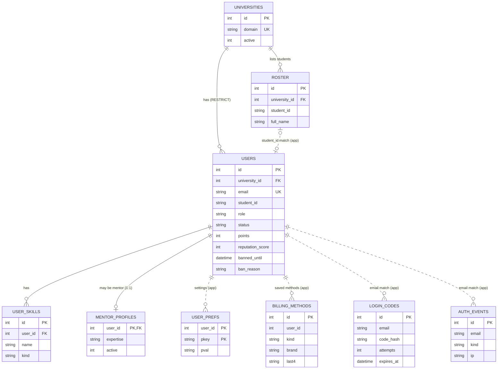

### ERD 2 – Social feed, messages and notifications

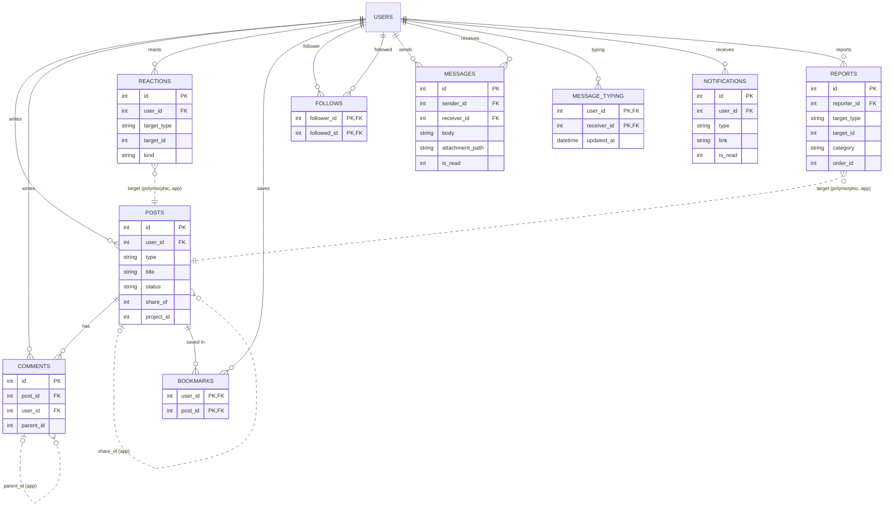

### ERD 3 – Projects

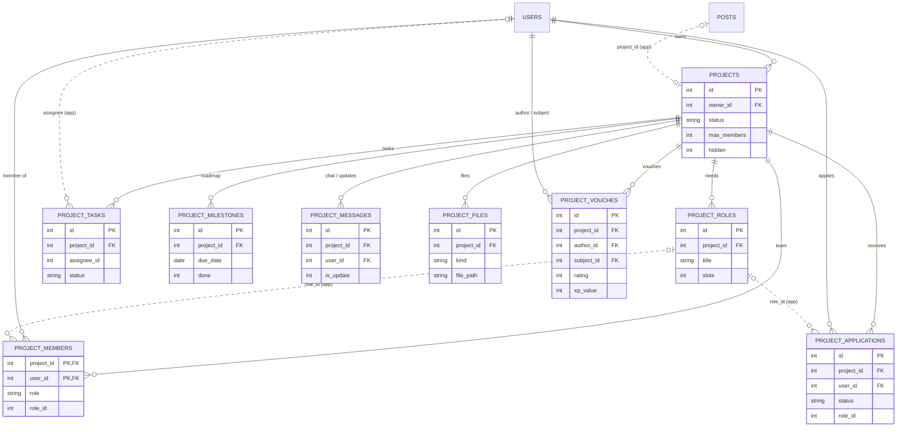

### ERD 4 – Marketplace and payments

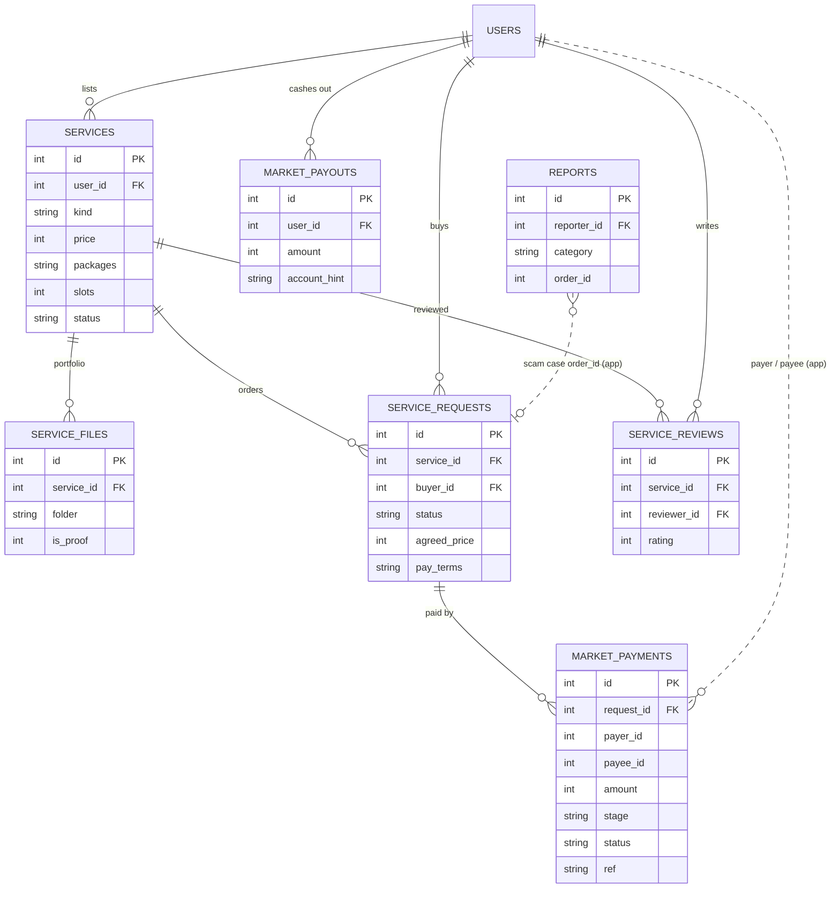

### ERD 5 – Learning, quizzes and live games

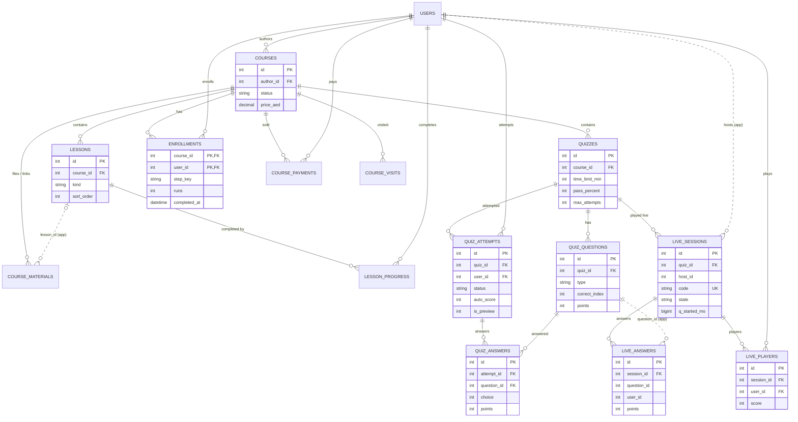

### ERD 6 – Gamification, mentorship and administration

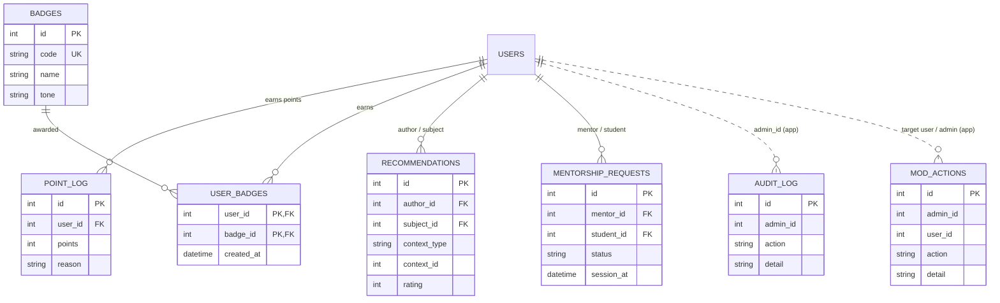

`SETTINGS` (`k`, `v`) is a standalone key/value table with no relationships.

## 4.8 System architecture [V]

### 4.8.1 Architectural style

MANBAR is a **server-rendered, layered monolith** built with plain PHP and no framework. It follows a lightweight **Model–View–Controller** separation:

| Layer | Files | Responsibility |
|---|---|---|
| Presentation (client) | HTML from the views; `public/assets/css/*.css` (11 files); `public/assets/js/*.js` (6 files); SVG images | Display, forms and interactive behaviour (vanilla JavaScript) |
| Front controller | `public/index.php` (and the root `index.php` adapter for shared hosting) | Session, security headers, CSRF check, routing and error handling |
| Routing table | `app/routes.php` | 177 entries in the form `[METHOD, '/path/{param}', 'handler']` |
| Controllers | `app/controllers/*.php` (14 files) | Request handling for each module |
| Domain services | `app/auth.php`, `app/gamify.php`, `app/learning.php`, `app/ai.php`, `app/mail.php`, `app/catalog.php` | Sign-in, reputation and badges, course path and files, AI assistant, SMTP, constants |
| Views | `app/views/*.php`, `app/views/admin/*.php`, `app/views/partials/*.php` (87 templates) | HTML templates with output escaping |
| Data access | `app/db.php` | PDO connection and query helpers (`qall`, `qrow`, `qval`, `qexec`, `insert`, `update`, `setting`) |
| Database | MariaDB / MySQL (55 tables) | Persistent data |
| File storage | `public/uploads/` (public), `storage/` (private) | User files |

### 4.8.2 Request lifecycle (from `public/index.php`)

1. Apache `mod_rewrite` (`public/.htaccess`) sends every request that is not a real file to `public/index.php`.
2. `require app/bootstrap.php` performs these steps:
   - enables strict types;
   - sets the error display (off when `MANBAR_ENV=production`);
   - loads `helpers.php`, `db.php`, `mail.php`, `auth.php`, `gamify.php`, `learning.php`, `ai.php` and `catalog.php`;
   - loads every file in `app/controllers/`.
3. `start_session()` starts a session named `MANBARSESS`. The session cookie is HttpOnly, uses `SameSite=Lax`, and is marked `secure` only when HTTPS is used.
4. Headers are sent: `X-Content-Type-Options: nosniff` and `X-Frame-Options: SAMEORIGIN`. The `.htaccess` files also add `Referrer-Policy`.
5. Every **POST** request is checked with `verify_csrf()`. There are two exceptions:
   - `/auth/google` is protected by Google's own double-submit `g_csrf_token` check in `auth_google()`.
   - `/stripe/webhook` is protected by an HMAC signature check in `stripe_verify_webhook()`.
6. The router turns each `{param}` into the named group `(?P<param>[^/]+)`, finds the first route that matches the method and path, and calls the handler with the parameters.
7. The handler does three things:
   - checks permissions with `require_login()`, `require_admin()`, `require_teacher()` or a module-specific check;
   - reads or writes data through PDO;
   - returns either `render(view, data, layout)` (HTML) or `json_out(...)` (JSON).
8. Errors are thrown as exceptions. `abort(code)` shows `app/views/error.php`.

### 4.8.3 How the technologies communicate

| From → To | Mechanism |
|---|---|
| Browser → PHP | HTTP GET for pages; HTTP POST for forms, which carry the hidden `_csrf` field |
| Browser JavaScript → PHP API | `fetch()` POST or GET with the `X-CSRF-Token` header, taken from `<meta name="csrf">`. Responses are JSON. |
| PHP → Browser | Server-rendered HTML; JSON for API routes; files streamed by `readfile()` for protected downloads |
| PHP → Database | PDO prepared statements (MySQL DSN with `charset=utf8mb4`; the session time zone is set to `+04:00`) |
| PHP → external services | cURL over HTTPS (Google token check, Gemini, Groq, OpenAI, Anthropic, Stripe). SMTP over a TLS or SSL socket (`app/mail.php`). |
| CSS / JavaScript | Static files served by Apache. Each module page loads its own assets (for example the `learn_assets`, `market_assets` and `project_assets` partials). |

**Live features use polling, not WebSockets [V]:**

| Feature | Endpoint | Interval |
|---|---|---|
| Unread counters | `GET /api/counts` | every 45 seconds (`app.js`) |
| Direct messages and typing indicator | `GET /api/messages/{id}?after=` | every 2 seconds, or 5 seconds when the tab is hidden (`app.js`, `poll()`) |
| Live quiz | `GET /live/{code}/state` and `/live/{code}/host/state` | – |
| Notifications pop-up | `GET /api/notifications` | loaded when the pop-up opens (`notify.js`) |

The live quiz uses no background job: `live_tick()` moves a question to "reveal" whenever the state is read after its timer has run out.

### 4.8.4 Authentication architecture

| Element | Implementation |
|---|---|
| Who is signed in | The session stores `uid`. `current_user()` loads the user and the university and rejects accounts that are not active. It also lifts an expired timed ban through `ban_lift_if_expired()`. |
| Sign-in | `login_user()` regenerates the session ID with `session_regenerate_id(true)` and records `last_login`. |
| Roles | `student`, `teacher` and `admin`, checked by `require_login()`, `require_teacher()` and `require_admin()` in `app/auth.php`. |
| Module permissions | `course_can_manage()`, `course_has_access()`, `project_can_manage()`, `project_member()`, `service_can_edit()`, plus ownership checks inside each action (for example `$isSeller` and `$isBuyer` in `service_order_action()`). |

### 4.8.5 Diagram source code

**Architecture (layers):**

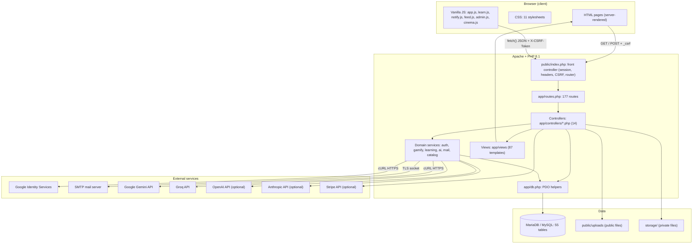

**Component diagram:**

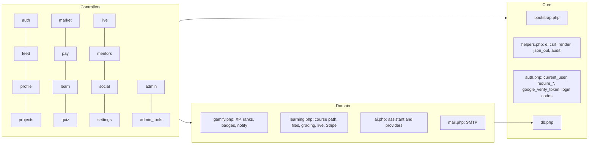

**Deployment diagram (local and production) [V from README and .htaccess]:**

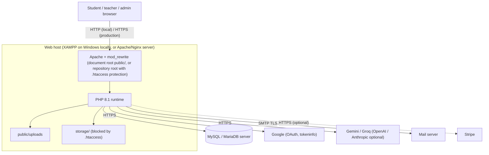

## 4.9 UML sequence diagrams (real workflows) [V]

### 4.9.1 Google or university-email sign-in

The functions are in `app/controllers/auth.php` and `app/auth.php`.

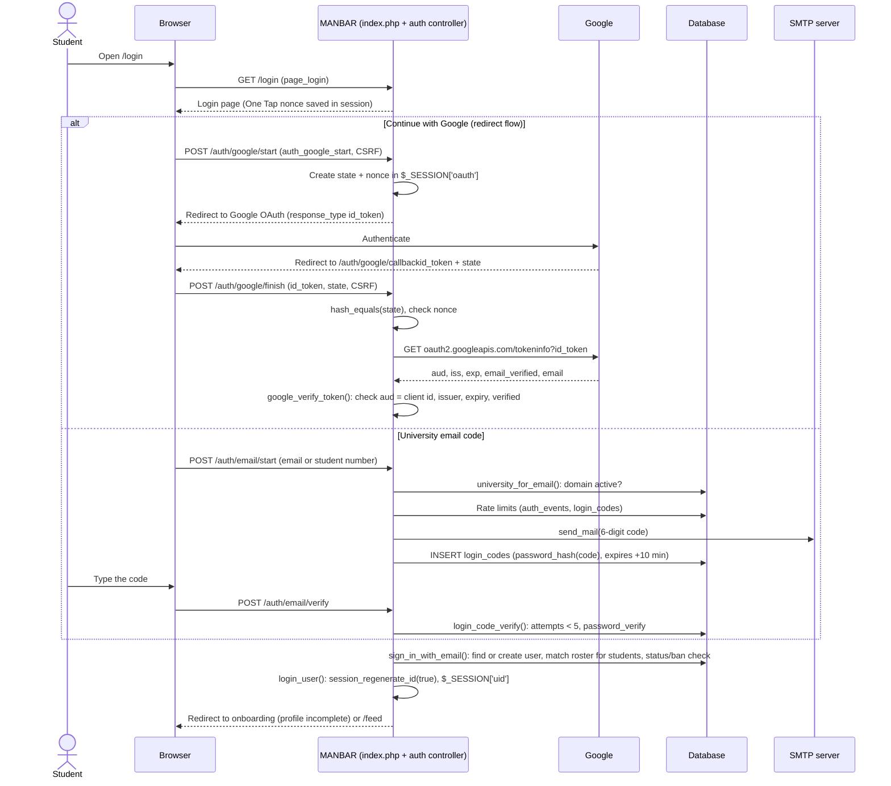

### 4.9.2 Project creation and team application

The functions are in `app/controllers/projects.php`.

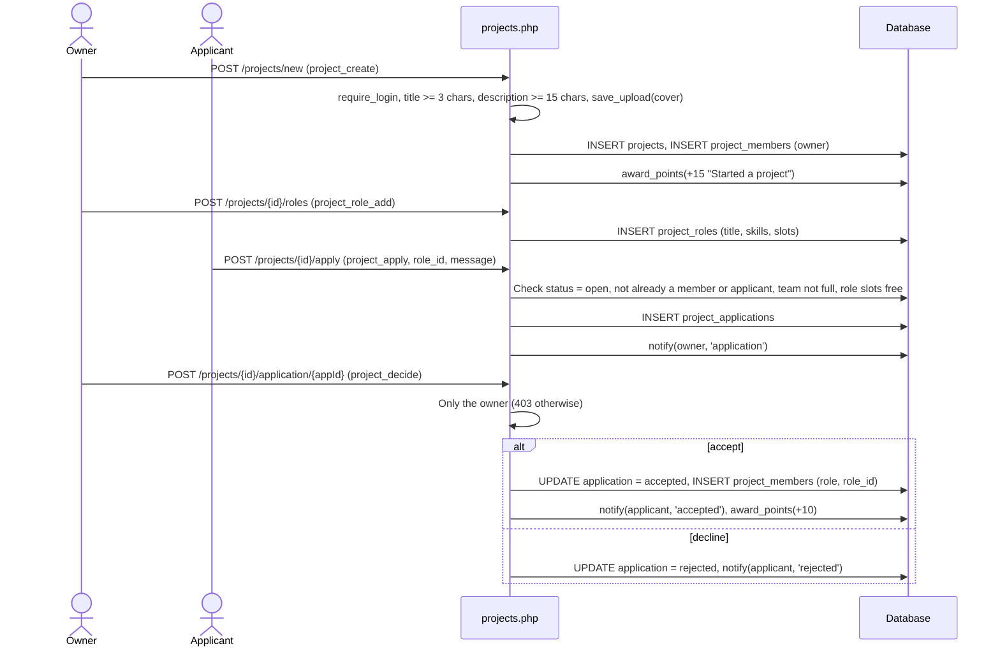

### 4.9.3 Marketplace order (person to person)

The functions are in `app/controllers/market.php` and `app/controllers/pay.php`.

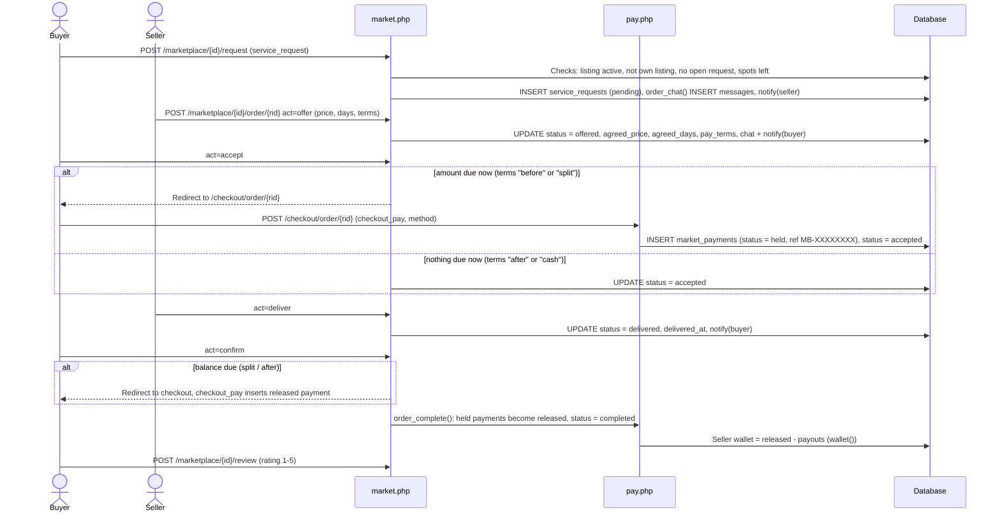

### 4.9.4 Course enrollment and quiz submission

The functions are in `app/controllers/learn.php`, `app/controllers/quiz.php` and `app/learning.php`.

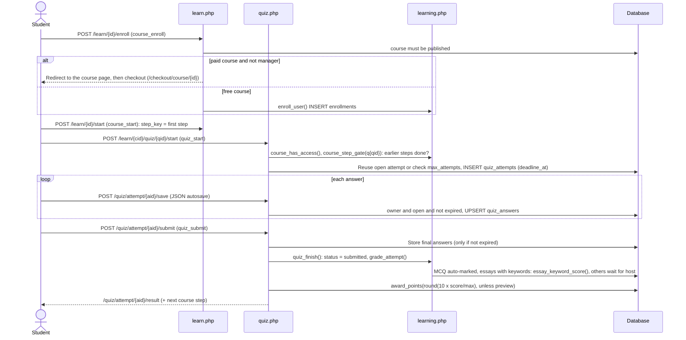

### 4.9.5 Live quiz session

The functions are in `app/controllers/live.php` and `app/learning.php`.

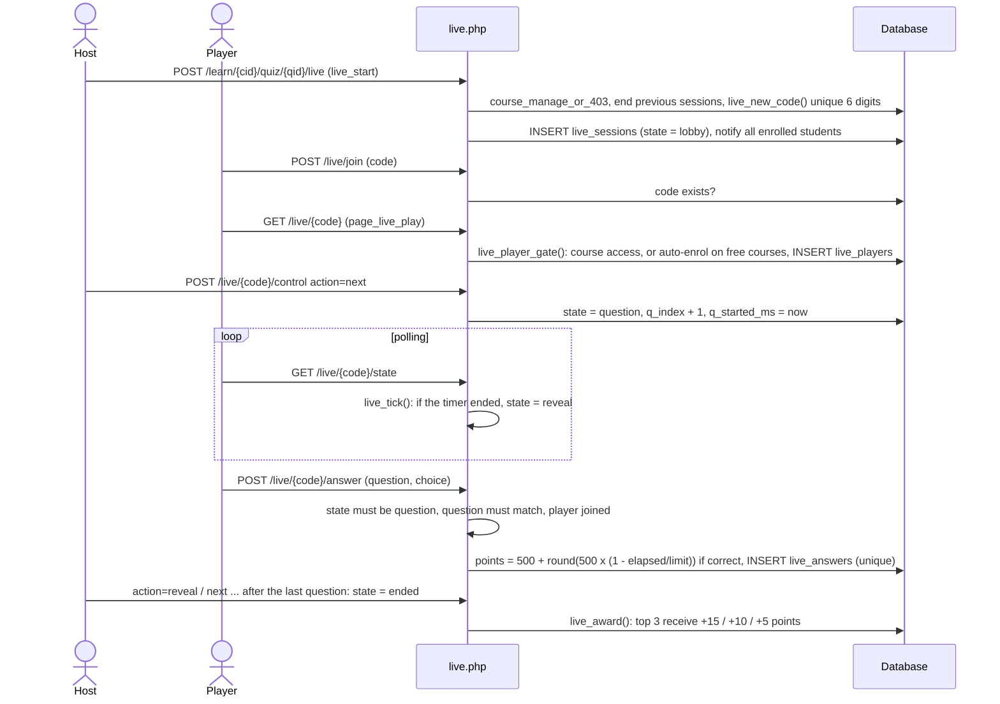

### 4.9.6 Messaging

The functions are in `app/controllers/social.php`; the client code is in `public/assets/js/app.js` (live direct messages section).

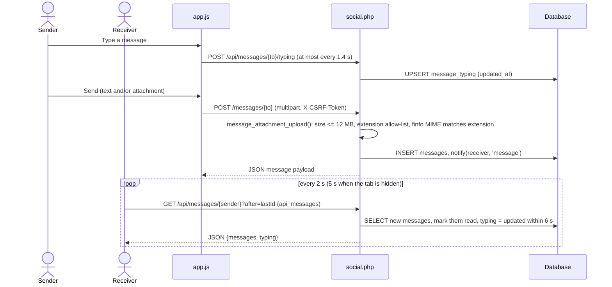

## 4.10 Activity diagrams [V]

**Activity 1 – Sign-in and account checks:**

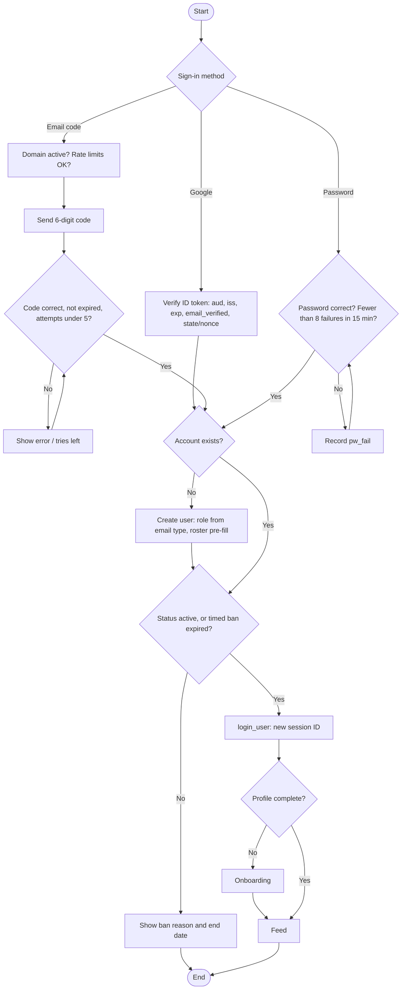

**Activity 2 – Marketplace order:**

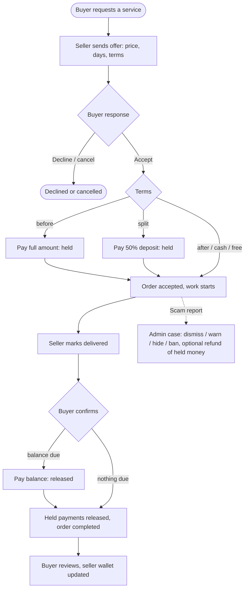

**Activity 3 – Quiz attempt:**

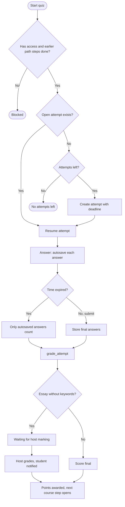

**Activity 4 – Scam report handling (administration):**

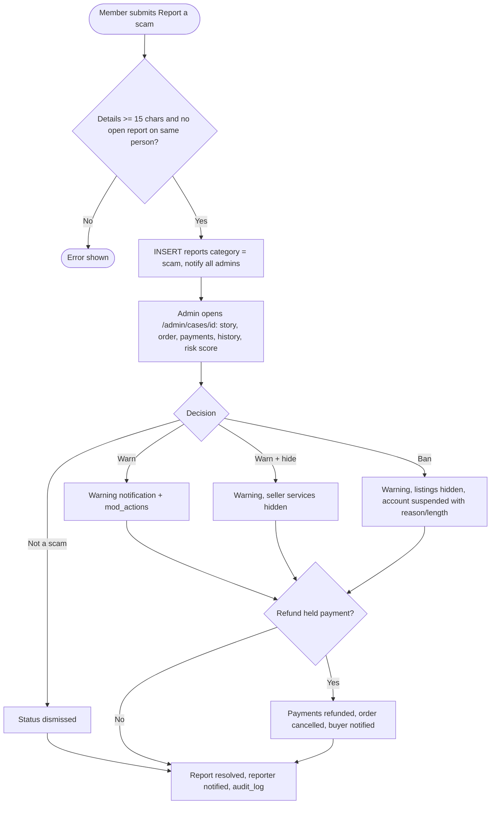

---

# CHAPTER 5 – SYSTEM IMPLEMENTATION

## 5.1 Module implementation map [V]

All file paths are relative to the project root. "JS" means a section of the named script file.

### Authentication and onboarding
- **Implemented:**
  - Google sign-in (redirect flow and One Tap);
  - 6-digit email codes;
  - optional password and password reset;
  - separate admin-console login;
  - roster matching;
  - onboarding;
  - product tour.
- **Controllers and functions:**
  - `app/controllers/auth.php`: `page_login`, `auth_google_start`, `page_google_callback`, `auth_google_finish`, `auth_google`, `auth_email_start`, `auth_email_code`, `auth_send_code`, `auth_email_verify`, `auth_email_password`, `auth_admin_login`, `auth_password_set`, `auth_password_skip`, `auth_dev`, `auth_logout`, `page_onboarding`, `onboarding_save`.
  - `app/auth.php`: `current_user`, `require_login`, `require_admin`, `require_teacher`, `login_user`, `university_for_email`, `normalize_university_email`, `login_code_send`, `login_code_verify`, `password_sign_in`, `google_verify_token`, `sign_in_with_email`.
  - Email delivery: `app/mail.php`: `send_mail`, `smtp_send`.
- **Tables:** `users`, `universities`, `roster`, `login_codes`, `auth_events`, `user_skills`.
- **Frontend:** `views/login.php`, `auth_*.php`, `onboarding.php`; `cinema.js` (sign-in animation sections); the Google GSI script `accounts.google.com/gsi/client`.
- **Security checks:**
  - state and nonce compared with `hash_equals`;
  - token audience, issuer, expiry and verified email;
  - hashed codes with expiry and an attempt limit;
  - rate limits;
  - `session_regenerate_id`;
  - university domain allow-list.

### Feed
- **Implemented:** 8 post types, photos, hashtags, 5 reactions, threaded comments, bookmarks, share, report, pin, edit, delete, search, saved posts, trending tags, sidebar widgets.
- **Controller:** `app/controllers/feed.php`: `fetch_posts`, `attach_reactions`, `sidebar_widgets`, `page_feed`, `page_post`, `post_create`, `post_update`, `post_delete`, `post_pin`, `save_upload`, `api_react`, `api_comment`, `api_comment_delete`, `api_bookmark`, `api_share`, `api_report`. Search is `page_search` in `social.php`.
- **Tables:** `posts`, `comments`, `reactions`, `bookmarks`, `reports`, `point_log`, `notifications`.
- **Frontend:** `views/feed.php`, `post.php`, `partials/post_card.php`, `comment.php`, `composer.php`; `app.js` (reactions; save, follow, share and report; comments; composer and AI assist; infinite "load more"); `feed.js` (home card effects); `feed.css`.
- **Security checks:**
  - ownership or admin check for edit and delete (`feed.php`, lines 192 and 205);
  - image upload limited to JPG/PNG/WebP/GIF by finfo, maximum `upload_max_mb = 4`;
  - output passed through `e()` / `rich()`.

### Profiles and people
- **Implemented:** profile pages, editing, cover, social links, name styles and effects, follow, verified recommendations (only after shared work, checked by `recommendation_eligibility()`), people directory with filters.
- **Controller:** `app/controllers/profile.php`: `profile_data`, `page_profile`, `page_profile_edit`, `profile_save`, `safe_url`, `safe_phone`, `profile_recommend`, `page_people`, `api_follow`.
- **Tables:** `users`, `user_skills`, `follows`, `recommendations`.
- **Frontend:** `views/profile.php`, `profile_edit.php`, `people.php`, `partials/profile_about.php`; `profile.css`; `app.js` (profile people dialogs, follow).
- **Security checks:** `safe_url()` accepts only http(s) URLs; phone numbers are sanitised; recommendations require shared work.

### Projects
- **Implemented:** board with skill matches, roles with places, applications, accept and decline, task board, team chat and updates, milestones, files (private until the project is completed), status, vouches.
- **Controller:** `app/controllers/projects.php`: `page_projects`, `project_create`, `page_project`, `project_apply`, `project_decide`, `project_leave`, `project_task_add`, `project_task_move`, `project_message`, `project_vouch`, `project_status`, `project_delete`, `project_role_add`, `project_milestone`, `project_files_add`, `project_file_delete`, `project_file`; helpers `project_can_manage`, `project_member`, `user_skill_set`.
- **Tables:** `projects`, `project_*` (9 tables), `posts.project_id`.
- **Frontend:** `views/projects.php`, `project.php`, `project_new.php`, `partials/project_files.php`; `projects.css`; `learn.js` ("Apply for this role", drop zone).
- **Security checks:**
  - only the owner may decide applications (403 otherwise);
  - files are served by `project_file()` only to members or admins, or to anyone once the project is completed;
  - files are stored in `storage/project_files`.

### Marketplace
- **Implemented:** offers and requests, packages, portfolio (files, folders, links), trust score, P2P order state machine, reviews, admin tools mode.
- **Controller:** `app/controllers/market.php`: `page_marketplace`, `service_create`, `service_save`, `service_cover`, `service_files_add`, `service_file`, `page_service`, `service_request`, `service_request_decide`, `service_order_action`, `service_review`, `service_toggle`, `page_orders`, `seller_trust`, `service_can_edit`, `market_admin_mode`.
- **Tables:** `services`, `service_files`, `service_requests`, `service_reviews`, `market_payments`, `messages`.
- **Order state machine:** pending → offered → accepted → delivered → completed (plus declined and cancelled).
- **Frontend:** `views/marketplace.php`, `service.php`, `service_new.php`, `orders.php`, partials `service_*`, `order_tracker.php`; `market.css`.
- **Security checks:**
  - every order action checks the user role (`$isSeller`, `$isBuyer`) and the current status, returning 403 when not allowed;
  - the offer price is limited to 0–100,000 and the delivery days to 1–90;
  - the portfolio upload uses `store_course_file()` (extension allow-list plus a finfo match, 25 MB) into `storage/service_files`.

### Payments [D]
- **Implemented:** checkout for courses and orders; the wallet; demo payouts; saved billing methods.
- **Controllers:**
  - `app/controllers/pay.php`: `page_checkout`, `checkout_pay`, `checkout_subject`, `order_due`, `order_complete`, `wallet`, `page_earnings`, `earnings_payout`, `pay_live`.
  - `app/controllers/settings.php`: `billing_add`, `billing_action`.
  - `app/learning.php`: `stripe_ready`, `stripe_api`, `course_payment_complete`, `stripe_verify_webhook`.
  - `app/controllers/learn.php`: `course_buy`, `course_paid`, `stripe_webhook`.
- **Tables:** `market_payments`, `market_payouts`, `course_payments`, `billing_methods`.
- **Frontend:** `views/checkout.php`, `earnings.php`, `settings.php`; `learn.js` (checkout section: brand detection, Luhn check, expiry, CVC); `notify.js` (saved-card form).
- **Security checks:**
  - card fields have no `name` attribute and are cleared before submit, so card data never reaches the server in demo mode;
  - saved methods store only the brand, last 4 digits, expiry and a masked hint;
  - IBAN and PayPal payouts store a masked hint;
  - the Stripe webhook is checked with HMAC-SHA256 and a 300-second timestamp tolerance.
- **Status:**
  - Course card payments go through Stripe Checkout only when `STRIPE_SECRET_KEY` is set [O]. The key is not configured in this installation.
  - All other methods (Apple Pay, PayPal, tabby, and order payments) are demo only [D].

### Learning center
- **Implemented:** courses (free and paid), lessons, summaries, files and links, cover, sequential path with drag-and-drop ordering, classmates, host or student view, host dashboard with CSV export, give and remove access.
- **Controllers:**
  - `app/controllers/learn.php`: `page_learn`, `page_my_courses`, `course_create`, `page_course`, `course_enroll`, `course_start`, `course_next`, `course_step_done`, `course_order_save`, `course_view_mode`, `lesson_add`, `lesson_edit`, `material_add`, `material_delete`, `material_file`, `course_cover`, `course_settings_save`, `page_course_dashboard`, `course_students_csv`, `course_student_add`, `course_student_remove`, `course_delete`.
  - `app/learning.php`: `can_create_courses` (teacher, admin, or Gold rank), `course_has_access`, `course_can_manage`, `course_path`, `course_step_gate`, `course_advance`, `enroll_user`, `store_course_file`, `video_embed_url`, `course_classmates`.
- **Tables:** `courses`, `lessons`, `enrollments`, `lesson_progress`, `course_materials`, `course_payments`, `course_visits`.
- **Frontend:** `views/learn.php`, `course.php`, `course_dashboard.php`, `my_courses.php`, partials `step_bar.php` and `materials.php`; `learn.js` (drag ordering with mouse, touch or arrow keys; drop zone; image viewer); `learn.css`.
- **Security checks:**
  - `material_file()` requires `course_has_access()`;
  - files are stored in `storage/course_files/{course}`, and a second `.htaccess` "Require all denied" file is written there automatically;
  - the extension and MIME type must match.

### Quizzes
- **Implemented:**
  - multiple-choice and essay questions;
  - bulk import from text or .docx (`docx_to_text`, `parse_question_text`);
  - time limit with autosave and auto-submit;
  - attempts limit, shuffling, pass mark;
  - essay keyword auto-marking, and manual grading with feedback;
  - results pages.
- **Controllers:**
  - `app/controllers/quiz.php`: `quiz_create`, `quiz_question_add`, `quiz_import`, `quiz_settings_save`, `quiz_start`, `quiz_test`, `attempt_load`, `quiz_answer_save`, `quiz_submit`, `quiz_finish`, `page_quiz_result`, `page_quiz_results`, `page_attempt_grade`, `attempt_grade_save`.
  - `app/learning.php`: `grade_attempt`, `essay_keyword_score`, `attempt_percent`.
- **Tables:** `quizzes`, `quiz_questions`, `quiz_attempts`, `quiz_answers`.
- **Frontend:** `views/quiz*.php`; `learn.js` (quiz player section).
- **Security checks:**
  - only the attempt owner may save answers, and only while the attempt is open and not expired (HTTP 409 otherwise);
  - multiple-choice answer indexes are checked against the number of options;
  - the host test run is stored with `is_preview = 1`.

### Live games
- **Implemented:** 6-digit code, lobby, host controls (next, reveal, end), speed-based scoring, leaderboard, podium, quizzes hub.
- **Controllers:**
  - `app/controllers/live.php`: `live_start`, `page_live_join`, `live_join`, `live_player_gate`, `page_live_play`, `page_live_host`, `live_state`, `live_host_state`, `live_answer`, `live_control`, `live_award`.
  - `app/learning.php`: `live_new_code`, `live_questions`, `live_tick`, `live_leaderboard`, `live_now_ms`.
- **Tables:** `live_sessions`, `live_players`, `live_answers`.
- **Frontend:** `views/live_host.php`, `live_play.php`, `live_join.php`; `learn.js` (live quiz section).
- **Security checks:**
  - only course managers control the game;
  - players need course access (or are auto-enrolled in a free course);
  - an answer must belong to the current question;
  - unique keys block a second answer to the same question.

### Mentors
- **Implemented:** directory, mentor page, request, accept or decline, scheduling, feedback.
- **Controller:** `app/controllers/mentors.php`: `page_mentors`, `page_mentor`, `mentor_request`, `page_mentorship`, `mentor_decide`.
- **Tables:** `mentor_profiles`, `mentorship_requests`.
- **Frontend:** `views/mentors.php`, `mentor.php`, `mentorship.php`.
- **Note [M]:** The mentorship controller is small (5 functions). Confirm the scheduling and feedback behaviour in the UI before describing it in detail.

### Achievements
- **Implemented:**
  - activity points and Rank XP;
  - 8 leagues × 3 stars of 150 XP (`LEVELS`, `RANK_STAR_XP` in `app/gamify.php`);
  - 24 badges (`BADGE_CATALOG`);
  - trust percentage.
- **Functions** (`app/gamify.php`): `level_for`, `reputation_breakdown`, `refresh_reputation_score`, `award_points`, `check_badges`, `give_badge`, `sync_badge_catalog`, `achievement_stats`, `badge_progress`, `recommendation_eligibility`, `notify`. The achievements page is `page_achievements` in `social.php`.
- **Tables:** `point_log`, `badges`, `user_badges`, `project_vouches`, `recommendations`, `service_reviews`, `users.reputation_score`.
- **XP formula [V]** (from `reputation_breakdown()`): Rank XP is the sum of:
  - activity points;
  - 2 × reactions on the user's posts, plus reactions on the user's comments;
  - review XP (5 stars = 100, 4 = 70, 3 = 35, 2 = 10);
  - the sum of vouch `xp_value`;
  - recommendation rating × 12;
  - 20 per completed order, 30 per completed project and 20 per completed mentorship.

### Messages
- **Implemented:** one-to-one chat, attachments (images, documents, ZIP and audio, at most 12 MB), voice recording (`app.js`), emoji panel, typing indicator, read status, automatic order messages.
- **Controller:** `app/controllers/social.php`: `page_messages`, `message_send`, `api_messages`, `api_message_typing`, `message_attachment_upload`, `message_payload`, `message_attachment_html`.
- **Tables:** `messages`, `message_typing`, `notifications`.
- **Frontend:** `views/messages.php`; `app.js` (live direct messages section, `poll()`).
- **Security checks:**
  - sending to yourself or to a user who does not exist is refused;
  - the attachment extension and MIME type must match;
  - **attachments are stored in public `uploads/messages` (see the limitations).**

### Notifications
- **Implemented:** centred pop-up dialog, mark all as read, open-and-mark-read, notifications page with category filters, per-category mute.
- **Controllers:**
  - `app/controllers/settings.php`: `notif_meta`, `notif_allowed`, `api_notif_peek`, `notif_read_all`, `notif_open`, `page_settings`, `settings_notifications_save`.
  - `notify()` in `gamify.php` skips muted categories.
  - `page_notifications` is in `social.php`.
- **Tables:** `notifications`, `user_prefs`.
- **Frontend:** `layout.php` (`<dialog id="notifPanel">`), `partials/notif_items.php`, `views/notifications.php`; `notify.js`; `notify.css`.
- **Security checks:** `notif_open()` only finds notifications that belong to the current user (`WHERE id = ? AND user_id = ?`).

### AI assistant
- **Implemented:**
  - writing correction with 5 tones;
  - form drafting for projects, services and courses;
  - intent routing;
  - catalogue search for posts, projects, people, mentors, courses and services;
  - the page-aware guide.
- **Functions:**
  - `app/ai.php`: `fix_writing` (local engine), `ai_form_draft`, `route_idea`, `ai_search_catalog`, `ai_gemini`, `ai_gemini_generate`, `ai_groq`, `ai_groq_generate`, `ai_openai`, `ai_llm` (Anthropic), `ai_assist`, `ai_guide_assist`.
  - `app/controllers/social.php`: `api_ai_assist`, `api_ai_guide`, `ai_request_guard`.
- **Tables:** read-only searches on `posts`, `projects`, `users`, `services`, `courses`, `user_skills`.
- **Frontend:** `app.js` (shared AI correction review, automatic local writing coach, composer and AI assist, AI guide widget); `partials/writing_tools.php`, `guide.php`.
- **Security checks:**
  - signed-in users only;
  - 30 requests per minute per session;
  - input limited to 4,000 characters;
  - keys are sent only in server-side HTTP headers.

### Administration
- **Implemented:**
  - dashboard with "needs attention" panel and SVG charts;
  - users list with CSV export;
  - user control panel: ban with reason and length, warn, add/remove/set XP, give or take badges, post actions, role, verified tick, delete;
  - scam case desk with refunds;
  - moderation tabs;
  - roster CSV import;
  - content control;
  - universities;
  - settings and audit log.
- **Controllers:**
  - `app/controllers/admin.php`: `page_admin`, `page_admin_users`, `admin_user_action`, `page_admin_roster`, `admin_roster_add`, `admin_roster_import`, `admin_roster_delete`, `page_admin_moderation`, `admin_moderate`, `page_admin_content`, `admin_course_toggle`, `page_admin_universities`, `admin_university_save`, `page_admin_settings`, `admin_settings_save`.
  - `app/controllers/admin_tools.php`: `ensure_admin_schema`, `mod_log`, `ban_lift_if_expired`, `ban_message`, `page_admin_user`, `admin_user_tools`, `report_scam`, `scam_orders`, `page_admin_case`, `admin_case_action`.
- **Tables:** all tables (read); written tables: `users`, `reports`, `mod_actions`, `audit_log`, `point_log`, `user_badges`, `posts`, `services`, `market_payments`, `service_requests`, `roster`, `universities`, `settings`.
- **Frontend:** `views/admin/*.php` (10 files); `admin.css`; `admin.js` (XP preview, reason prompts); `sidebar.css`.
- **Security checks:**
  - every admin handler calls `require_admin()`;
  - admins cannot suspend, delete, demote or ban themselves;
  - XP is limited so that Rank XP never drops below 0 (and a single change is capped at +100,000);
  - roster CSV rows are validated (student ID of at least 6 digits, and a name).

## 5.2 External API integration [V]

| Service | Code location | How it communicates | Configuration setting (name only) | Status in this installation |
|---|---|---|---|---|
| Google Identity Services | `app/controllers/auth.php` (`auth_google_start`, `auth_google_finish`, `auth_google`); `app/auth.php` (`google_verify_token`) | Browser: GSI script and OAuth redirect (`response_type=id_token`). Server: GET `https://oauth2.googleapis.com/tokeninfo?id_token=…` with cURL (10-second timeout), then checks aud, iss, exp and email_verified. | `GOOGLE_CLIENT_ID` (no client secret is used) | **Configured** |
| SMTP email | `app/mail.php` (`send_mail`, `smtp_send`) | A PHP stream socket using SSL (port 465) or STARTTLS with TLS 1.2/1.3 (port 587). When mail is not configured and the `show_codes_on_screen` setting is on, codes are written to `storage/mail.log` instead. When mail is not configured and that setting is off, sign-in by code is refused with an error. | `MANBAR_MAIL_HOST`, `_PORT`, `_SECURE`, `_USER`, `_PASS`, `_FROM` | **Configured** |
| Google Gemini | `app/ai.php` (`ai_gemini_generate`, `ai_gemini`, `ai_gemini_form_draft`) | POST `https://generativelanguage.googleapis.com/v1beta/models/{model}:generateContent`. The key is sent in the `x-goog-api-key` header. The response is JSON (`responseMimeType: application/json`). Timeouts: 25 s (8 s to connect). | `GEMINI_API_KEY`, `GEMINI_MODEL` | **Configured** (first engine tried) |
| Groq | `app/ai.php` (`ai_groq_generate`, `ai_groq`, `ai_groq_form_draft`) | POST `https://api.groq.com/openai/v1/chat/completions` (OpenAI-compatible). Bearer key header. Timeouts: 25 s / 8 s. | `GROQ_API_KEY`, `GROQ_MODEL` | **Configured** (fallback) |
| OpenAI | `app/ai.php` (`ai_openai`) | POST `https://api.openai.com/v1/responses` | `OPENAI_API_KEY`, `OPENAI_MODEL` | **Optional – not configured [O]**. The default model name in `config/config.php` should be checked before it is cited [M]. |
| Anthropic Claude | `app/ai.php` (`ai_llm`) | POST `https://api.anthropic.com/v1/messages` with the `x-api-key` and `anthropic-version` headers | `ANTHROPIC_API_KEY`, `ANTHROPIC_MODEL` | **Optional – not configured [O]** |
| Stripe Checkout | `app/learning.php` (`stripe_api`, `stripe_verify_webhook`, `course_payment_complete`); `app/controllers/learn.php` (`course_buy`, `course_paid`, `stripe_webhook`) | REST calls to `https://api.stripe.com/v1/`. The webhook `POST /stripe/webhook` is checked with HMAC-SHA256. | `STRIPE_SECRET_KEY`, `STRIPE_WEBHOOK_SECRET` | **Optional – not configured [O]**. Checkout runs in demo mode [D]. |
| PayPal, Apple Pay, tabby | `views/checkout.php`, `pay.php` | No external call: these are only UI and demo records | – | **Demo only [D]**. Real integration is a future plan [F]. |
| YouTube and Vimeo | `video_embed_url()` (`app/learning.php`) | iframe embeds (`youtube-nocookie.com`, `player.vimeo.com`) | – | Active |
| Google Fonts | `views/partials/head.php` | CSS link | – | Active |

**AI engine order [V]** (from `ai_assist()`):
1. Gemini
2. Groq
3. OpenAI
4. Anthropic
5. Local PHP engine (`fix_writing`, `route_idea`)

**Data sent to AI providers [V]:**
- The user's text, limited to 4,000 characters.
- A tone instruction.
- An optional page context of up to 180 characters.
- A short profile context built by `ai_user_prompt_context()`: role, major, faculty, headline and up to 12 skills.

No passwords, emails or database credentials are included. Searching MANBAR's own data (`ai_search_catalog`) is done in PHP and SQL, not by the AI.

## 5.3 Security implementation (evidence-based) [V]

| Area | What the code does | Evidence | Assessment / limits |
|---|---|---|---|
| Authentication | University-domain allow-list; Google token verification; email codes; optional password; separate admin password login | `app/auth.php` (`university_for_email`, `google_verify_token`, `login_code_*`, `password_sign_in`); `auth_admin_login()` | Sound for the intended scope. Token verification uses Google's `tokeninfo` endpoint rather than checking the JWT signature locally; this is acceptable, but every sign-in depends on that network call. |
| Authorization | Role checks (`require_admin`, `require_teacher`); ownership and membership checks in each module | `app/auth.php`, lines 21–45; per-controller checks (for example `project_decide`, `service_order_action`, `material_file`, `project_file`, `billing_action`, `notif_open`) | Checks are placed in each handler, so new handlers must remember to add them. Testing confirmed a 403 for a non-admin on `/admin/users/{id}` and a 404 for another user's billing method [V-T]. |
| Password hashing | `password_hash(PASSWORD_DEFAULT)` (bcrypt) with `password_needs_rehash`; sign-in codes are also hashed | `app/auth.php`, lines 172 and 193–205; `auth_password_set` | Implemented correctly. |
| CSRF | A 48-hex-character session token (`random_bytes(24)`) checked with `hash_equals` on every POST, through the form field or the `X-CSRF-Token` header | `app/helpers.php`, `csrf_token` and `verify_csrf`; `public/index.php`, line 24 | Covers every POST route. Exceptions: `/auth/google` (Google `g_csrf_token` double-submit check) and `/stripe/webhook` (HMAC). [M] An earlier development note says Apache showed HTTP 500 instead of 419 when the token expired; re-check this. |
| SQL injection | All user input is passed as PDO parameters; emulated prepares are off | `app/db.php` | A scan of all `qall`/`qrow`/`qval`/`qexec` calls found 16 SQL strings that insert variables. All of them use code-defined identifiers (table names, column definitions in schema updates, or the `update()` helper's column list), never user input. Sorting uses fixed lists (for example `$order` in `market.php`, line 196). |
| XSS | `e()` uses `htmlspecialchars(ENT_QUOTES \| ENT_SUBSTITUTE)`; `rich()` escapes first, then links hashtags and URLs | `app/helpers.php`, lines 13 and 127 | An automated scan found no request value printed without escaping. The five raw `input()` outputs only produce fixed strings such as `checked`. **A full manual audit of all 87 templates has not been done [M].** There is no Content-Security-Policy header. |
| File uploads | finfo MIME check, extension allow-list, size limits, random file names; private files stored outside the public folder | `save_upload` (images, 4 MB); `store_course_file` (25 MB; courses and services); project files; `message_attachment_upload` (12 MB) | `public/uploads/.htaccess` blocks script execution (`.php` and others). **Message attachments are public by URL [V].** |
| Session management | Named session; HttpOnly; `SameSite=Lax`; `secure` flag on HTTPS; ID regenerated at sign-in; logout clears the session and cookie | `app/helpers.php` (`start_session`); `auth_logout` | There is no server-side idle timeout. The session cookie lasts until the browser closes (lifetime 0). |
| Access control on files | `material_file`, `project_file` and `service_file` stream files only after a permission check; `storage/` is blocked by `.htaccess` | `app/controllers/learn.php`, line 331; `projects.php`, line 405 | Effective for course, project and service files. |
| Admin permissions | `require_admin()` on all admin routes; no self-ban or self-demotion; every action logged in `audit_log` and `mod_actions` | `app/controllers/admin.php`, `admin_tools.php` | Verified by test [V-T]. |
| Bans | `status = suspended` plus `ban_reason` and `banned_until`; checked on every request (`current_user`) and at sign-in; timed bans lift automatically | `app/auth.php`, line 11; `admin_tools.php` (`ban_lift_if_expired`) | Verified by test [V-T]. |
| Rate limiting | Email codes: 1 per 60 s, 5 per hour per email, 20 per hour per IP. Code attempts: 5. Password failures: 8 per 15 min. Admin login: 5 per 15 min (10 per IP). AI: 30 per minute per session. | `app/auth.php`, `auth_admin_login`, `ai_request_guard` | **No rate limiting** on posting, commenting, messaging, reporting or uploads. AI limiting is per session, not per IP. |
| HTTP headers | `nosniff`, `X-Frame-Options: SAMEORIGIN`; `Referrer-Policy` through `.htaccess` | `public/index.php`, `.htaccess` | No HSTS or CSP. HTTPS depends on the deployment. |
| Development login | `/auth/dev` works only when `dev_login` is true; it is currently false | `auth_dev()` | Must remain off in production. |
| Error display | `display_errors` is on unless `MANBAR_ENV=production` | `app/bootstrap.php` | Set `MANBAR_ENV=production` in deployment. |

---

# CHAPTER 6 – SYSTEM TESTING

## 6.1 Existing testing evidence [V]

1. **There is no automated test suite in the project.**
   - There is no PHPUnit or other test framework, no `tests/` folder, and no test configuration.
   - The only test-related project file is `database/mail_test.php`, a manual command-line script that sends one test email (`php database/mail_test.php you@example.com`). No result log for it was found in the project.
2. **A static check was executed for this analysis on 10 October 2026:**
   - Command, for every PHP file in `app/`, `config/`, `database/`, `public/` and the root `index.php`: `C:\xampp\php\php.exe -l <file>`
   - **Result: 123 files checked, 0 syntax errors [V-T].**
3. **End-to-end HTTP tests were run during development.**
   - These were Bash scripts using `curl` with cookie-jar sessions. They are **not stored in the project**; they were in the developer assistant's temporary working folder.
   - Environment: Windows 11, XAMPP (Apache with PHP 8.1.25), MariaDB 10.4.32, Git Bash with curl. The site ran at `http://localhost/manbar/public`. Demo data was installed.
   - Prerequisite: to create sessions for demo accounts, each script switched `dev_login` on in `config/config.local.php`, signed in with `POST /auth/dev`, and switched `dev_login` off again straight away. Each script recorded the highest IDs before running and **rolled back** all data it created afterwards.
   - The following runs have **verbatim output preserved in the development session** and can be cited:

| Run | Coverage | Observed result |
|---|---|---|
| `st_test.sh` (Settings and notifications) | 8 pages (`/settings` with 4 tabs, `/notifications` with 3 filters, `/feed`): HTTP code and PHP warning count | All returned 200 with 0 PHP errors |
| | `GET /api/notifications` | `ok True`, 10 items |
| | Saving a card | 302; database row stored only `visa`, `4242`, `12`, `2029` and the holder name |
| | Invalid card (`last4=42`, month 13, year 2020) | No row was created |
| | PayPal and tabby | Stored masked hints only (`k•••@example.com`, `+971 5• ••• ••81`) |
| | Another user removing the method | 404 |
| | Make default | Default changed to the card |
| | Read-all through XHR | `{"ok":true,"unread":0}` |
| | Open a notification | 302 to its link; `is_read` became 1 |
| `st_test2.sh` | Social category muted, then a follow | 0 notifications |
| | Social category on, then a follow | 1 notification |
| | Checkout lists the saved method | 1 option ("Mastercard •••• 4444") |
| `ad_test.sh` (Administration) | 7 admin pages | All returned 200 with 0 PHP errors |
| | Scam button on a listing and a profile | Present |
| | Non-admin opening `/admin/users/13` | 403 |
| | Scam report | Report created (category scam, order linked, amount 200); admin notified; a duplicate open report was blocked |
| | Case page | Showed "AED 200 is still held" |
| | Ban 7 days with refund | User suspended with reason; both listings hidden; payment refunded; order cancelled; report resolved |
| | Banned user | Session redirected to `/login`; sign-in showed "This account is suspended until … Reason: …" |
| | Lift ban | Status active, `banned_until` NULL |
| | XP +150 | 1087 → 1237 |
| | Set rank Gold ★ | 900 |
| | Badge give, then remove | 1, then 0 |
| | Warning | Notification created |
| | Post hide, then delete with a reason | Status hidden, then deleted; author notified |
| | Self-ban | Blocked |
| | Rollback | All values restored |

4. **Other development test runs** covered:
   - the projects module (`pj_test.sh`: roles, milestones, file permissions);
   - marketplace orders and payment terms;
   - the course path, uploads and quizzes hub.

   These were reported as passing during earlier development sessions, but **their raw output was not preserved**. Mark them **Not Executed (evidence not available)** in the report unless they are re-run.

5. **Visual checks** were done in a browser at desktop, tablet and phone widths and in light and dark mode. These were observations recorded during development; no usability study with users was carried out.

## 6.2 Functional test cases

Result values:
- **Pass** – executed with preserved evidence (6.1).
- **Not Executed** – a procedure is given; run it before reporting a result.

| Test ID | Objective | Preconditions | Input | Procedure | Expected result | Actual result | Status |
|---|---|---|---|---|---|---|---|
| TC-AUTH-01 | Valid university email sign-in | Mail configured; domain active; roster row exists | A student-number email | `/login` → type the email → receive the code → enter it | Account created as student, profile pre-filled from roster, redirected to onboarding | – | Not Executed |
| TC-AUTH-02 | Non-university email rejected | – | `someone@gmail.com` | Submit on `/login` | Error listing the allowed university domains; no code sent | – | Not Executed |
| TC-AUTH-03 | Wrong code limit | A code has been requested | 5 wrong 6-digit codes | Submit 5 times | "tries left" message each time; after 5, "Too many wrong tries" | – | Not Executed |
| TC-AUTH-04 | Code expiry | A code is older than 10 minutes | The old code | Submit it | "This code has expired" | – | Not Executed |
| TC-AUTH-05 | Banned account cannot sign in | User banned for 7 days | Sign in | Attempt to sign in | Message with the end date and reason | Message shown "until … Reason: Scam or fraud…" | Pass |
| TC-AUTH-06 | Ban ends an active session | User is signed in | Admin bans the user | User requests `/feed` | Redirect to `/login` | 302 → `/login` | Pass |
| TC-PRJ-01 | Create a project | Signed in | Title of at least 3 characters, description of at least 15 | `POST /projects/new` | Project created; owner is a member; +15 points | – | Not Executed |
| TC-PRJ-02 | Validation | Signed in | Title "ab" | Submit | Error "Add a title and a description (15+ characters)" | – | Not Executed |
| TC-PRJ-03 | Apply for a role | Open project with a role that has free places | Role and message | Apply | Application stored; owner notified | – | Not Executed |
| TC-PRJ-04 | Duplicate or full-role application blocked | Already applied, or role full | Apply again | Submit | Error message; no new row | – | Not Executed |
| TC-PRJ-05 | Only the owner decides | Non-owner signed in | `POST /projects/{id}/application/{appId}` | Submit | HTTP 403 | – | Not Executed |
| TC-MKT-01 | Create a listing | Signed in | Title, category, price, packages, cover | `/marketplace/new` | Listing visible in the marketplace | – | Not Executed |
| TC-MKT-02 | Request own listing blocked | Owner signed in | Request own listing | Submit | "You cannot request your own listing" | – | Not Executed |
| TC-MKT-03 | Full order flow ("before" terms) | Buyer and seller | Offer of AED 100, 3 days, before | request → offer → accept → checkout → deliver → confirm | Payment held, then released; order completed; seller wallet +100 | – | Not Executed |
| TC-MKT-04 | Wrong role on an order action | Buyer signed in | `act=deliver` | Submit | HTTP 403 | – | Not Executed |
| TC-PAY-01 | Save a card stores only safe data | Signed in | Test card 4242… | Settings → Billing → Save card | Row with brand, last 4, expiry and holder only | As expected | Pass |
| TC-PAY-02 | Invalid card refused | Signed in | last4 = "42", month 13 | POST | No row created | No row created | Pass |
| TC-PAY-03 | Other user's method protected | Two users | Remove another user's method | POST | 404 | 404 | Pass |
| TC-PAY-04 | Saved method at checkout | User has a saved card; paid course not owned | – | Open `/checkout/course/{id}` | Saved option listed | 1 option listed | Pass |
| TC-LRN-01 | Create a course | Teacher, admin or Gold rank | Title and category | `/learn/new` | Course created (draft or published) | – | Not Executed |
| TC-LRN-02 | Create a course without rights | Bronze student | – | `/learn/new` | Refused | – | Not Executed |
| TC-LRN-03 | Enrol in a free course | Published free course | – | Enroll | Enrollment row; course opens | – | Not Executed |
| TC-LRN-04 | Paid course needs checkout | Paid course | – | Enroll | Redirect; no enrollment until paid | – | Not Executed |
| TC-LRN-05 | Sequential path gate | Step 1 not completed | Open step 2 quiz | Start the quiz | Blocked by `course_step_gate` | – | Not Executed |
| TC-QZ-01 | Create a quiz and import questions | Course host | Text in the documented import format | Import, preview, save | Questions created | – | Not Executed |
| TC-QZ-02 | Answer and auto-grade | Enrolled student | MCQ answers | Start → answer → submit | Score shown; points = round(10 × score/max) | – | Not Executed |
| TC-QZ-03 | Time limit | `time_limit_min` = 1 | – | Wait past the deadline, then save | Save returns 409 "Time is up"; submit counts autosaved answers only | – | Not Executed |
| TC-QZ-04 | Attempts limit | `max_attempts` = 1, one attempt used | Start again | Submit | "You have used all your attempts" | – | Not Executed |
| TC-QZ-05 | Essay manual grading | Essay without keywords | Host grade and feedback | Grade page | Score updated; student notified | – | Not Executed |
| TC-LIVE-01 | Join with a valid code | Host started a game | 6-digit code | `/live` → join | Player added to the lobby | – | Not Executed |
| TC-LIVE-02 | Invalid code | – | "123" or an unknown code | Join | "No live quiz with that code" | – | Not Executed |
| TC-LIVE-03 | Scoring | Question open | Correct answer after about 50% of the time | Answer | About 750 points (500 + 500 × 0.5) | – | Not Executed |
| TC-LIVE-04 | Double answer blocked | Already answered | Answer again | POST | Rejected by the unique key | – | Not Executed |
| TC-MSG-01 | Send a text message | Two users | "Hello" | Send | Message appears for the receiver within about 2 s; notification created | – | Not Executed |
| TC-MSG-02 | Valid attachment | – | 1 MB PDF | Attach and send | Stored; link shown | – | Not Executed |
| TC-MSG-03 | Invalid attachment | – | `.exe` file, or a renamed file whose content does not match | Send | Error "does not match its extension" or file type refused | – | Not Executed |
| TC-MSG-04 | Size limit | – | 13 MB file | Send | "Attachments can be up to 12 MB" | – | Not Executed |
| TC-AI-01 | Writing correction | Signed in | Text with spelling errors | Assistant → correct | Corrected text and changes; engine name shown | – | Not Executed |
| TC-AI-02 | Too-short input | – | "hi" | Submit | 422 "Write a few words first" | – | Not Executed |
| TC-AI-03 | Rate limit | – | 31 requests within 60 s | Script | 31st request returns 429 | – | Not Executed |
| TC-AI-04 | Fallback without keys | AI keys removed (test copy only) | Text | Submit | Local engine result | – | Not Executed |
| TC-NOT-01 | Pop-up lists notifications | User has notifications | – | `GET /api/notifications` | JSON with items | `ok`, 10 items | Pass |
| TC-NOT-02 | Mark all read | Unread notifications exist | – | POST read-all (XHR) | unread = 0 | `{"ok":true,"unread":0}` | Pass |
| TC-NOT-03 | Muted category | Social muted | Another user follows | – | No notification | 0 created | Pass |
| TC-ADM-01 | Non-admin blocked | Student session | – | `GET /admin/users/13` | 403 | 403 | Pass |
| TC-ADM-02 | Admin pages load | Admin session | – | 7 admin URLs | 200, no PHP errors | All 200, 0 errors | Pass |
| TC-ADM-03 | Adjust XP | Admin | +150; set 900 | Control panel | Score changes; logged | 1087 → 1237; 900 | Pass |
| TC-ADM-04 | Self-ban prevented | Admin on own page | Ban | Submit | Error message | Blocked | Pass |
| TC-MOD-01 | Scam report and case | Buyer with held payment | Report, then admin bans with refund | – | Suspended, listings hidden, payment refunded, order cancelled | As expected | Pass |
| TC-MOD-02 | Duplicate scam report | Open report exists | Report again | Submit | Blocked | Blocked | Pass |
| TC-MOD-03 | Content removal with a reason | Admin | Hide, then delete a post with a reason | – | Status changes; author notified | As expected | Pass |
| TC-ROS-01 | Roster CSV import | Admin | CSV: header row plus valid and invalid rows | Admin → Roster → Import | Valid rows added or updated; invalid rows counted as skipped ("rows skipped") | – | Not Executed |
| TC-ROS-02 | Roster match at sign-in | Imported student | Sign in with that student's email | – | Name, major and year pre-filled | – | Not Executed |

## 6.3 Other testing

**Boundary Value Analysis.** No BVA was executed [V]. The proposed values below come from the real limits in the code.

| Field | Rule in code | Boundary values to test |
|---|---|---|
| Sign-in code | Exactly 6 digits, at most 5 attempts, 10 minutes valid | 5 and 7 digits; 6 digits; attempts 4, 5 and 6; ages 9:59 and 10:01 |
| Post or cover image | Maximum 4 MB (`upload_max_mb`) | 3.99 MB, 4.00 MB, 4.01 MB |
| Course, service or project file | Maximum 25 MB | 24.9 MB, 25 MB, 25.1 MB |
| Message attachment | Above 0 bytes and up to 12 MB | 0 B, 1 B, 12 MB, 12 MB + 1 B |
| Project team size | `max_members` limited to 2–30 | 1, 2, 30, 31 |
| Project title / description | At least 3 / at least 15 characters | 2 / 14 and 3 / 15 |
| Order offer | Price 0–100,000; days 1–90 | −1, 0, 100,000, 100,001; days 0, 1, 90, 91 |
| AI text | At least 4 characters; cut at 4,000 | 3, 4, 4,000, 4,001 |
| AI rate | 30 per minute | 30th and 31st request |
| Scam report details | At least 15 characters | 14, 15 |
| Admin XP | Total never below 0; change capped at +100,000 | Remove more than the current score |
| Live code | 6 digits | 5, 6, 7 digits |

**Equivalence Partitioning.** No EP was executed. Proposed classes:
- **Email:** valid university domain / inactive university domain / non-university domain / badly formed address.
- **Upload type:** allowed type / allowed extension whose content does not match / disallowed extension.
- **Role:** student / teacher / admin / signed out.
- **Order status:** each of pending, offered, accepted, delivered, completed, declined and cancelled, combined with each action.

**Integration testing.**
- The `curl` runs in 6.1 are integration tests: browser-level HTTP, then PHP, then the database, then notifications.
- They were executed only for settings, notifications, billing and administration flows with preserved evidence.
- The Google, Gemini and Groq integrations are in use in this installation, but **no recorded integration test results** exist [M].

**Security testing.**
- Executed with evidence: authorization checks (403 or 404), ban enforcement, self-ban prevention, masked billing storage [V-T].
- Not executed: CSRF rejection test, XSS payload test, SQL injection test, upload bypass test, session fixation test.
- Proposed procedure:
  - POST without `_csrf` → expect 419;
  - post the payload `<script>alert(1)</script>` → expect it shown as text;
  - send `' OR 1=1 --` in search → expect a normal result;
  - upload `shell.php` renamed to `.png` → expect a MIME mismatch error;
  - compare the session ID before and after sign-in → expect it to change.

**Performance testing.**
- **Not performed. No measurements exist.**
- Proposed procedure:
  - Apache Bench `ab -n 200 -c 10` or k6 against `/`, `/login` and signed-in `/feed`, recording average and 95th-percentile response times;
  - measure the polling load (one active chat sends 30 requests per minute);
  - use the browser DevTools Lighthouse report for page weight.

**Usability testing.**
- **Not performed with users.**
- Proposed procedure: 5–8 AAU students complete 6 tasks (sign in, post an idea, apply to a project, request a service, take a quiz, join a live game). Record task success, time and System Usability Scale (SUS) scores.

---

# CHAPTER 7 – CONCLUSION AND RECOMMENDATIONS

## 7.1 Project achievements (verified from the code) [V]

- A working full-stack web platform:
  - 177 routes, 14 controllers and 87 templates;
  - 55-table relational database with 69 enforced foreign keys and 14 unique constraints;
  - all 123 PHP files pass a syntax check.
- University-only sign-in with three methods (Google, email code, password), roster matching and an admin-only console login.
- Integrated modules:
  - feed, profiles and people;
  - projects with roles, tasks, milestones, files and vouches;
  - marketplace with a P2P order state machine and escrow-like payment states;
  - learning center with a sequential path;
  - quizzes with auto-grading and keyword-based essay marking;
  - live multiplayer quizzes with speed scoring;
  - mentorship, messaging with attachments and voice, notifications with per-category muting;
  - settings with masked billing;
  - achievements (24 badges, 24 rank steps, a transparent XP formula);
  - an AI writing assistant with multiple providers and a local fallback;
  - a complete moderation and administration toolset, including scam cases with refunds.
- A self-updating schema (`ensure_*_schema`), so new features upgrade existing databases without manual migrations.
- Deployment support for both a `public/` document root and shared hosting (root `index.php` plus a protective `.htaccess`).

## 7.2 Development challenges (supported by history and files) [V]

- **Apache configuration portability.** Commit `a26034b` ("Fix Apache 500: remove <Directory> from .htaccess, make uploads rule portable") shows that `.htaccess` rules had to be rewritten for XAMPP and shared hosts.
- **Shared-host deployment.** Commit `e36bd39` ("Prepare MANBAR for secure shared-host deployment") added the root adapter and the deny rules for `app`, `config`, `database`, `docs` and `storage`.
- **AI reliability and cost.**
  - Commits `05796b6`, `ad3ad0a` and `b20c0ed` added OpenAI, Gemini and a Groq fallback one after another.
  - The code keeps a local engine, so the assistant still works when no provider is available.
- **Schema evolution without a migration tool.** About 12 `ensure_*_schema()` functions add columns at runtime. This avoided manual migrations, but spreads schema knowledge across many files.
- **Real-time features without WebSockets.** Shared PHP hosting led to a polling design (`live_tick()` "no background job is needed"; message polling every 2 s).
- **Payment providers.** Real provider accounts were not available, so only Stripe is coded for live use, and the other methods were built as clearly labelled demo flows.
- **[M] Local tooling.** A headless browser profile was left in `.impeccable/.edge-profile/`. It is git-ignored, and it is not relevant to the report unless you discuss the development tools.

## 7.3 Current limitations [V]

1. **Payments** [D]:
   - PayPal, Apple Pay and tabby are demo only.
   - Marketplace order payments are recorded in the database but no real money moves.
   - Stripe is coded for course card payments but not configured.
   - Payouts are demo records.
2. **Optional AI providers** [O]: OpenAI and Anthropic are not configured. AI quality depends on external free tiers (Gemini, Groq).
3. **Message attachments are public by URL.** They are stored in `public/uploads/messages/`, protected only by a random file name.
4. **No automated test suite** and no recorded performance or usability measurements.
5. **Real-time behaviour uses polling.** Chat polls every 2 s per open conversation, which costs more server work at scale and adds a short delay.
6. **Missing security hardening:**
   - no Content-Security-Policy or HSTS headers;
   - no rate limits on posting, messaging, reporting or uploads;
   - no server-side session idle timeout;
   - `display_errors` stays on unless the environment is set to production.
7. **Polymorphic references** (`reactions`, `reports`, `recommendations`) have no database foreign keys. Deleted targets can leave orphan rows.
8. **The email domain list and roster** are managed by hand (CSV import). There is no live integration with university systems.
9. **The interface is in English only.** The Arabic name is shown, but the interface is not translated and has no right-to-left layout.
10. **Notifications are in-app only.** There are no email or push notifications.
11. **Version control risk.** At the time of analysis, Git showed **35 modified and 58 untracked files**. A large part of the recent work (settings, notifications, admin tools, marketplace payments, quizzes and live views, and others) is **not yet committed**. Commit and back up this work before submission.

## 7.4 Future improvements (recommendations) [F]

- **Production deployment:**
  - HTTPS with HSTS;
  - `MANBAR_ENV=production`;
  - CSP and Permissions-Policy headers;
  - backups of the database and of `storage/`;
  - the document root set to `public/`.
- **Real payments:**
  - Stripe for orders, with Stripe Connect payouts to sellers;
  - official PayPal and tabby APIs;
  - refunds through the providers;
  - reconciliation reports.
- **Security:**
  - move message attachments into `storage/` behind a permission-checked download route;
  - add per-user and per-IP rate limits on write actions;
  - add a session idle timeout;
  - run an independent security review (OWASP ASVS checklist).
- **Testing:**
  - add PHPUnit tests for `grade_attempt`, `reputation_breakdown`, `order_due` and `level_for`;
  - turn the curl scripts into a stored, repeatable integration suite;
  - add CI with GitHub Actions running `php -l` and the tests.
- **Scalability:**
  - replace polling with WebSockets or Server-Sent Events (for example a small Node or Ratchet server, or a managed service);
  - add caching for feed and statistics queries;
  - move file storage to object storage (for example S3-compatible storage).
- **Data integrity:** add a cleanup job (or triggers) for polymorphic orphans; consider a migration tool.
- **Accessibility and language:** Arabic translation with right-to-left layout, a WCAG 2.1 AA audit, and usability testing with students.
- **Additional universities:** activate ADU and UAEU domains from Admin → Universities, add an automated roster integration, then open to the public as planned.
- **Notifications:** email digests and web push (PWA).

---

## Appendix A – Verification summary

| Item | Status |
|---|---|
| Tables, primary keys, foreign keys, unique keys, delete rules, SQL definitions | Verified from the live database (`information_schema`, `mysqldump --no-data`) |
| Routes, controllers, functions, file paths | Verified from the source code |
| Security mechanisms listed in 5.3 | Verified from the source code; effectiveness verified by test only where marked [V-T] |
| External integration configuration status | Verified (setting filled in or empty; values not read into this document) |
| PHP syntax check (123 files, 0 errors) | Executed on 10 October 2026 |
| Settings, notifications, billing and administration test results | Executed during development with preserved output |
| Projects, marketplace order, course, quiz, live, messaging, AI and roster test results | **Not executed with preserved evidence** – re-run before citing |
| Performance and usability results | **Do not exist** |
| Apache 419-to-500 behaviour, mentorship scheduling details, default OpenAI model name, full XSS template audit | **Needs manual verification [M]** |

## Appendix B – Useful commands (read-only)

```bash
# Database structure only (no data)
C:\xampp\mysql\bin\mysqldump.exe -u root --no-data --skip-comments --compact manbar > schema.sql

# Foreign keys and delete rules
C:\xampp\mysql\bin\mysql.exe -u root -e "SELECT rc.TABLE_NAME, kcu.COLUMN_NAME, rc.REFERENCED_TABLE_NAME, rc.DELETE_RULE FROM information_schema.REFERENTIAL_CONSTRAINTS rc JOIN information_schema.KEY_COLUMN_USAGE kcu ON kcu.CONSTRAINT_NAME=rc.CONSTRAINT_NAME AND kcu.TABLE_NAME=rc.TABLE_NAME WHERE rc.CONSTRAINT_SCHEMA='manbar'"

# Syntax check of one PHP file
C:\xampp\php\php.exe -l app\controllers\market.php

# Route count
findstr /R /C:"\['GET'" /C:"\['POST'" app\routes.php
```
